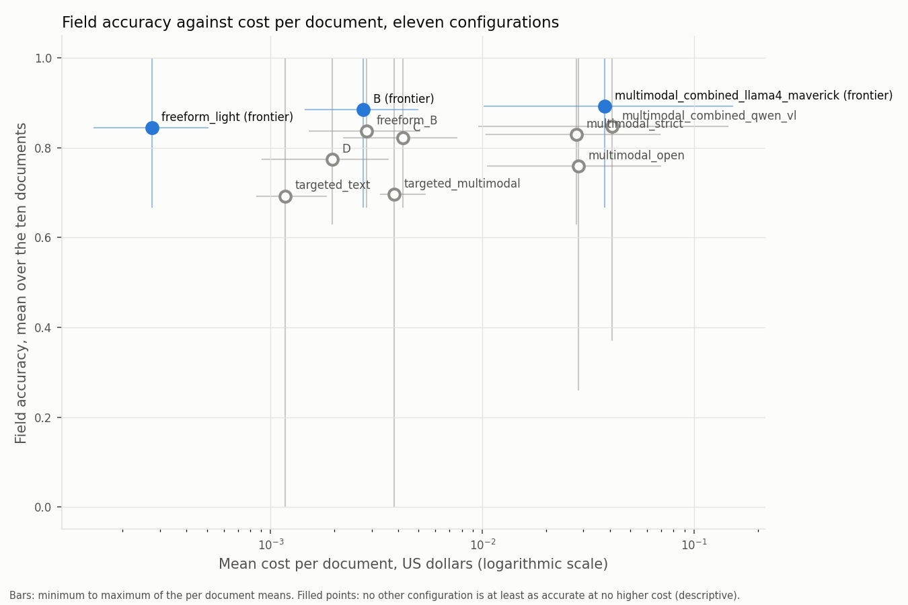

# Evaluation report

Batch `batch_20261030T105636Z`. Private report: it contains real document names, partner names and values.

## 1. Batch overview

1. Code that produced the runs: commit `1380dc7`; scored with the scorer at commit `86e6d71` on 2026-11-09T09:00:40Z.
2. Runs from 2026-10-30T10:56:36Z to 2026-10-31T14:50:31Z (UTC).
3. 330 final runs: 11 configurations, 10 documents, 3 repetitions; 6 runs ended without a final record.
4. Total cost of the completed final runs USD 4.54; total end to end time 25.1 hours.
5. Author's decisions applied: 34 from review_decisions.csv.

## 2. Reading notes

1. Times are end to end, from PDF to final record. For the five text configurations (B, C, D, freeform_B, freeform_light) they include the Docling conversion of the document, run on the author's laptop processor; see `DOCLING_SPEED.md`.
2. The six runs of targeted_text and targeted_multimodal on SP03B ended without a final record and are counted as failures: every field and every gold partner missed. They are left out of every time and cost figure.
3. Six documents (SP01, SP02, SP03A, SP03B, SP04, SP05) state partner amounts in thousands of euros, with the scale only in a table caption or header; amounts copied as written are a thousand times too small and are scored as wrong amounts.
4. SP01: the Docling Markdown lost the partner table, which affects the five text configurations.
5. Values marked unsure come from partner names the rules could not settle; they carry half scores.

## 3. Configuration summary

Means over the ten per document means (each the mean of three runs), with minimum and maximum.

| Configuration | Field accuracy | Partner recall | Amount accuracy | Fully correct | Consistency | Over inclusion | Valid first attempt | Cost per document (USD) | Cost of pass (USD) | Mean seconds |
|---|---|---|---|---|---|---|---|---|---|---|
| multimodal_combined_llama4_maverick (frontier) | 89.3 % (66.7 % to 100.0 %) | 87.1 % | 54.1 % | 10.0 % | 92.0 % | 22.7 % | 100.0 % | 0.0379 | 0.3792 | 215 |
| B (frontier) | 88.5 % (66.7 % to 100.0 %) | 94.2 % | 53.5 % | 10.0 % | 97.0 % | 10.2 % | 100.0 % | 0.0027 | 0.0274 | 288 |
| multimodal_combined_qwen_vl | 84.8 % (37.0 % to 100.0 %) | 85.9 % | 76.2 % | 16.7 % | 90.0 % | 27.6 % | 83.3 % | 0.0409 | 0.2452 | 598 |
| freeform_light (frontier) | 84.4 % (66.7 % to 100.0 %) | 90.6 % | 72.5 % | 20.0 % | 99.0 % | 15.7 % | 10.0 % | 0.0003 | 0.0014 | 315 |
| freeform_B | 83.7 % (66.7 % to 100.0 %) | 63.2 % | 56.9 % | 10.0 % | 91.0 % | 38.6 % | 100.0 % | 0.0028 | 0.0283 | 310 |
| multimodal_strict | 83.0 % (63.0 % to 100.0 %) | 96.6 % | 10.0 % | 10.0 % | 88.0 % | 50.7 % | 100.0 % | 0.0277 | 0.2774 | 272 |
| C | 82.2 % (66.7 % to 100.0 %) | 67.8 % | 55.0 % | 10.0 % | 97.0 % | 35.5 % | 100.0 % | 0.0042 | 0.0420 | 270 |
| D | 77.4 % (63.0 % to 100.0 %) | 65.5 % | 60.1 % | 10.0 % | 96.0 % | 44.0 % | 100.0 % | 0.0020 | 0.0196 | 269 |
| multimodal_open | 75.9 % (25.9 % to 100.0 %) | 78.1 % | 26.0 % | 10.0 % | 86.0 % | 54.6 % | 86.7 % | 0.0285 | 0.2845 | 396 |
| targeted_multimodal | 69.6 % (0.0 % to 100.0 %) | 73.1 % | 74.7 % | 6.7 % | 86.0 % | 25.8 % | 90.0 % | 0.0038 | 0.0573 | 78 |
| targeted_text | 69.3 % (0.0 % to 100.0 %) | 57.2 % | 57.0 % | 10.0 % | 83.0 % | 43.8 % | 90.0 % | 0.0012 | 0.0117 | 14 |

## 4. Errors per configuration

Weighted error counts per field over all thirty final runs of each configuration (0.5 for errors from unsure names).

### B

| Field | Error class | Weighted count |
|---|---|---|
| partners | miss | 16 |
| partners.requested_cents | miss | 33 |
| partners.requested_cents | wrong | 61 |
| proposal.call_identifier | miss | 3 |
| proposal.call_identifier | unsupported | 3 |
| proposal.proposal_title | wrong | 3 |
| proposal.submission_date | miss | 3 |
| proposal_facts.mcrl_target | miss | 3 |
| proposal_facts.requested_total_cents | wrong | 1 |
| proposal_facts.trl_start | miss | 9 |
| proposal_facts.trl_target | miss | 6 |

### C

| Field | Error class | Weighted count |
|---|---|---|
| partners | miss | 81 |
| partners.requested_cents | miss | 26 |
| partners.requested_cents | wrong | 40 |
| proposal.call_identifier | miss | 3 |
| proposal.call_identifier | unsupported | 3 |
| proposal.proposal_acronym | miss | 3 |
| proposal.proposal_title | miss | 3 |
| proposal.proposal_title | wrong | 6 |
| proposal.submission_date | miss | 3 |
| proposal.submission_date | unsupported | 3 |
| proposal_facts.mcrl_target | miss | 3 |
| proposal_facts.requested_total_cents | miss | 3 |
| proposal_facts.requested_total_cents | wrong | 3 |
| proposal_facts.trl_start | miss | 9 |
| proposal_facts.trl_target | miss | 6 |

### D

| Field | Error class | Weighted count |
|---|---|---|
| partners | miss | 83 |
| partners.requested_cents | miss | 65 |
| partners.requested_cents | wrong | 22 |
| proposal.call_identifier | miss | 3 |
| proposal.call_identifier | unsupported | 3 |
| proposal.proposal_acronym | miss | 3 |
| proposal.proposal_title | miss | 3 |
| proposal.proposal_title | wrong | 6 |
| proposal.submission_date | miss | 3 |
| proposal.submission_date | unsupported | 3 |
| proposal_facts.mcrl_start | miss | 2 |
| proposal_facts.mcrl_target | miss | 3 |
| proposal_facts.mcrl_target | unsupported | 2 |
| proposal_facts.requested_total_cents | miss | 6 |
| proposal_facts.requested_total_cents | wrong | 9 |
| proposal_facts.trl_start | miss | 6 |
| proposal_facts.trl_start | wrong | 3 |
| proposal_facts.trl_target | miss | 3 |
| proposal_facts.trl_target | wrong | 3 |

### freeform_B

| Field | Error class | Weighted count |
|---|---|---|
| partners | miss | 82 |
| partners.requested_cents | miss | 14 |
| partners.requested_cents | wrong | 52 |
| proposal.call_identifier | miss | 3 |
| proposal.call_identifier | unsupported | 3 |
| proposal.call_identifier | wrong | 3 |
| proposal.proposal_title | wrong | 7 |
| proposal.submission_date | miss | 3 |
| proposal.submission_date | unsupported | 3 |
| proposal_facts.mcrl_target | miss | 3 |
| proposal_facts.requested_total_cents | miss | 2 |
| proposal_facts.requested_total_cents | wrong | 4 |
| proposal_facts.trl_start | miss | 6 |
| proposal_facts.trl_start | wrong | 1 |
| proposal_facts.trl_target | miss | 5 |
| proposal_facts.trl_target | wrong | 1 |

### freeform_light

| Field | Error class | Weighted count |
|---|---|---|
| partners | miss | 21 |
| partners.requested_cents | miss | 19 |
| partners.requested_cents | wrong | 33 |
| proposal.call_identifier | miss | 3 |
| proposal.call_identifier | unsupported | 3 |
| proposal.call_identifier | wrong | 3 |
| proposal.proposal_acronym | miss | 3 |
| proposal.proposal_title | wrong | 6 |
| proposal.submission_date | miss | 3 |
| proposal_facts.mcrl_target | miss | 3 |
| proposal_facts.requested_total_cents | miss | 3 |
| proposal_facts.trl_start | miss | 9 |
| proposal_facts.trl_target | miss | 6 |

### multimodal_combined_llama4_maverick

| Field | Error class | Weighted count |
|---|---|---|
| partners | duplicate | 7 |
| partners | miss | 28 |
| partners.requested_cents | miss | 28 |
| partners.requested_cents | wrong | 61 |
| proposal.call_identifier | miss | 3 |
| proposal.call_identifier | wrong | 3 |
| proposal.proposal_title | wrong | 6 |
| proposal.submission_date | unsupported | 7 |
| proposal_facts.mcrl_start | miss | 1 |
| proposal_facts.mcrl_target | miss | 1 |
| proposal_facts.trl_start | miss | 4 |
| proposal_facts.trl_target | miss | 4 |

### multimodal_combined_qwen_vl

| Field | Error class | Weighted count |
|---|---|---|
| partners | duplicate | 27 |
| partners | miss | 31 |
| partners | unsupported_extra | 1 |
| partners.requested_cents | miss | 9 |
| partners.requested_cents | wrong | 33 |
| proposal.call_identifier | miss | 3 |
| proposal.call_identifier | unsupported | 3 |
| proposal.proposal_title | wrong | 9 |
| proposal.submission_date | unsupported | 10 |
| proposal_facts.mcrl_start | unsupported | 3 |
| proposal_facts.mcrl_target | unsupported | 6 |
| proposal_facts.mcrl_target | wrong | 1 |
| proposal_facts.trl_start | unsupported | 3 |
| proposal_facts.trl_target | unsupported | 3 |

### multimodal_open

| Field | Error class | Weighted count |
|---|---|---|
| partners | duplicate | 33 |
| partners | miss | 58 |
| partners | unsupported_extra | 2 |
| partners.requested_cents | miss | 122 |
| partners.requested_cents | wrong | 22 |
| proposal.call_identifier | miss | 1 |
| proposal.call_identifier | unsupported | 3 |
| proposal.call_identifier | wrong | 5 |
| proposal.proposal_title | wrong | 9 |
| proposal.submission_date | unsupported | 5 |
| proposal_facts.mcrl_start | miss | 3 |
| proposal_facts.mcrl_start | unsupported | 3 |
| proposal_facts.mcrl_start | wrong | 1 |
| proposal_facts.mcrl_target | miss | 3 |
| proposal_facts.mcrl_target | unsupported | 3 |
| proposal_facts.mcrl_target | wrong | 1 |
| proposal_facts.requested_total_cents | wrong | 6 |
| proposal_facts.trl_start | miss | 3 |
| proposal_facts.trl_start | unsupported | 3 |
| proposal_facts.trl_start | wrong | 3 |
| proposal_facts.trl_target | miss | 9 |
| proposal_facts.trl_target | unsupported | 3 |
| proposal_facts.trl_target | wrong | 1 |

### multimodal_strict

| Field | Error class | Weighted count |
|---|---|---|
| partners | duplicate | 45 |
| partners | miss | 12 |
| partners | unsupported_extra | 3 |
| partners.requested_cents | miss | 207 |
| partners.requested_cents | wrong | 3 |
| proposal.call_identifier | miss | 3 |
| proposal.call_identifier | unsupported | 3 |
| proposal.call_identifier | wrong | 3 |
| proposal.proposal_title | wrong | 6 |
| proposal.submission_date | unsupported | 8 |
| proposal.submission_date | wrong | 3 |
| proposal_facts.mcrl_start | unsupported | 1 |
| proposal_facts.mcrl_start | wrong | 1 |
| proposal_facts.mcrl_target | unsupported | 1 |
| proposal_facts.mcrl_target | wrong | 2 |
| proposal_facts.requested_total_cents | wrong | 6 |
| proposal_facts.trl_start | unsupported | 1 |
| proposal_facts.trl_start | wrong | 3 |
| proposal_facts.trl_target | miss | 3 |
| proposal_facts.trl_target | unsupported | 1 |
| proposal_facts.trl_target | wrong | 1 |

### targeted_multimodal

| Field | Error class | Weighted count |
|---|---|---|
| partners | miss | 56 |
| partners.requested_cents | miss | 24 |
| partners.requested_cents | wrong | 18 |
| proposal.call_identifier | miss | 6 |
| proposal.call_identifier | unsupported | 3 |
| proposal.call_identifier | wrong | 3 |
| proposal.proposal_acronym | miss | 3 |
| proposal.proposal_title | miss | 3 |
| proposal.proposal_title | wrong | 7 |
| proposal.submission_date | miss | 3 |
| proposal.submission_date | unsupported | 3 |
| proposal_facts.mcrl_start | miss | 12 |
| proposal_facts.mcrl_target | miss | 9 |
| proposal_facts.requested_total_cents | miss | 3 |
| proposal_facts.requested_total_cents | wrong | 3 |
| proposal_facts.trl_start | miss | 9 |
| proposal_facts.trl_start | wrong | 3 |
| proposal_facts.trl_target | miss | 12 |

### targeted_text

| Field | Error class | Weighted count |
|---|---|---|
| partners | miss | 120 |
| partners.requested_cents | miss | 34 |
| partners.requested_cents | wrong | 38 |
| proposal.call_identifier | miss | 6 |
| proposal.proposal_acronym | miss | 3 |
| proposal.proposal_title | miss | 3 |
| proposal.proposal_title | wrong | 11 |
| proposal.submission_date | miss | 3 |
| proposal.submission_date | unsupported | 3 |
| proposal_facts.mcrl_start | miss | 12 |
| proposal_facts.mcrl_target | miss | 9 |
| proposal_facts.requested_total_cents | miss | 3 |
| proposal_facts.requested_total_cents | wrong | 3 |
| proposal_facts.trl_start | miss | 12 |
| proposal_facts.trl_target | miss | 15 |

## 5. Wrong values per document

For every document and field, each wrong or missing value beside the gold value, with the configurations and repetitions that produced it.

### Abico_Synth

| Item | Field | Partner | Gold value | Error | Extracted value | Runs |
|---|---|---|---|---|---|---|
| field | proposal.call_identifier |  | 7421_18_2026 | miss | null | B 1, B 2, B 3, C 1, C 2, C 3, D 1, D 2, D 3, freeform_B 1, freeform_B 2, freeform_B 3, freeform_light 1, freeform_light 2, freeform_light 3, multimodal_combined_llama4_maverick 1, multimodal_combined_llama4_maverick 2, multimodal_combined_llama4_maverick 3, multimodal_combined_qwen_vl 1, multimodal_combined_qwen_vl 2, multimodal_combined_qwen_vl 3, multimodal_open 2, multimodal_strict 1, multimodal_strict 2, multimodal_strict 3, targeted_multimodal 1, targeted_multimodal 2, targeted_multimodal 3, targeted_text 1, targeted_text 2, targeted_text 3 |
| field | proposal.call_identifier |  | 7421_18_2026 | wrong | HORIZON-CL5-2026-D3-01 | multimodal_open 1, multimodal_open 3 |
| field | proposal.proposal_title |  | Renewable Composite Systems with Circular Engineering | wrong | Renewable Composite Systems with Circular Engineering ReCoSE | C 1, C 2, C 3, D 1, D 2, D 3, freeform_B 1, freeform_B 2, freeform_B 3, freeform_light 1, freeform_light 2, freeform_light 3, multimodal_combined_llama4_maverick 1, multimodal_combined_llama4_maverick 2, multimodal_combined_llama4_maverick 3, multimodal_combined_qwen_vl 1, multimodal_combined_qwen_vl 2, multimodal_combined_qwen_vl 3, multimodal_open 1, multimodal_open 2, multimodal_open 3, multimodal_strict 1, multimodal_strict 2, multimodal_strict 3, targeted_multimodal 1, targeted_multimodal 2, targeted_multimodal 3, targeted_text 1, targeted_text 2, targeted_text 3 |
| field | proposal.submission_date |  | null | unsupported | 2026-01-15 | multimodal_open 1 |
| field | proposal.submission_date |  | null | unsupported | 2026-03-01 | multimodal_combined_llama4_maverick 1, multimodal_combined_llama4_maverick 2, multimodal_combined_llama4_maverick 3, multimodal_combined_qwen_vl 1, multimodal_combined_qwen_vl 3 |
| field | proposal.submission_date |  | null | unsupported | 2026-04-01 | multimodal_open 3 |
| field | proposal_facts.mcrl_start |  | null | unsupported | 2 | multimodal_open 1, multimodal_open 3 |
| field | proposal_facts.mcrl_start |  | null | unsupported | 3 | multimodal_open 2, multimodal_strict 1 |
| field | proposal_facts.mcrl_target |  | null | unsupported | 4 | multimodal_open 1 |
| field | proposal_facts.mcrl_target |  | null | unsupported | 5 | multimodal_open 3, multimodal_strict 1 |
| field | proposal_facts.mcrl_target |  | null | unsupported | 6 | multimodal_open 2 |
| field | proposal_facts.requested_total_cents |  | 221860000 | wrong | 217760000 | targeted_multimodal 1 |
| field | proposal_facts.requested_total_cents |  | 221860000 | wrong | 354540000 | targeted_text 2 |
| field | proposal_facts.requested_total_cents |  | 221860000 | wrong | 386000000 | B 1, D 1, D 2, D 3, freeform_B 1, freeform_B 2, freeform_B 3, targeted_multimodal 2, targeted_multimodal 3, targeted_text 1, targeted_text 3 |
| field | proposal_facts.trl_start |  | null | unsupported | 3 | multimodal_open 1, multimodal_open 2, multimodal_open 3, multimodal_strict 1 |
| field | proposal_facts.trl_target |  | null | unsupported | 5 | multimodal_open 1, multimodal_strict 1 |
| field | proposal_facts.trl_target |  | null | unsupported | 6 | multimodal_open 2, multimodal_open 3 |
| partner | partners | Coastal Finland University | Coastal Finland University | miss | null | freeform_B 1, freeform_B 2, freeform_B 3, freeform_light 1, freeform_light 2, freeform_light 3, multimodal_combined_llama4_maverick 1, multimodal_combined_llama4_maverick 2, multimodal_combined_llama4_maverick 3, multimodal_combined_qwen_vl 1, targeted_text 1, targeted_text 2, targeted_text 3 |
| partner | partners | Eastern Nordic University | Eastern Nordic University | miss | null | freeform_B 1, freeform_B 2, freeform_B 3, freeform_light 1, freeform_light 2, freeform_light 3, multimodal_combined_llama4_maverick 1, multimodal_combined_llama4_maverick 2, multimodal_combined_llama4_maverick 3, multimodal_combined_qwen_vl 1, targeted_text 1, targeted_text 2, targeted_text 3 |
| partner | partners | Lake District Technical University | Lake District Technical University | miss | null | B 1, multimodal_open 1, multimodal_open 2, multimodal_open 3, targeted_multimodal 2, targeted_multimodal 3, targeted_text 2, targeted_text 3 |
| partner | partners | Nordic Institute for Sustainable Materials | Nordic Institute for Sustainable Materials | miss | null | freeform_B 1, freeform_B 2, freeform_B 3, freeform_light 1, freeform_light 2, freeform_light 3, multimodal_combined_llama4_maverick 1, multimodal_combined_llama4_maverick 2, multimodal_combined_llama4_maverick 3, multimodal_combined_qwen_vl 1, targeted_text 1, targeted_text 2, targeted_text 3 |
| partner | partners | Northern Lakes University of Applied Sciences | Northern Lakes University of Applied Sciences | miss | null | B 1, B 2, B 3, C 1, C 2, C 3, D 1, D 2, D 3, freeform_B 1, freeform_B 2, freeform_B 3, freeform_light 1, freeform_light 2, freeform_light 3, multimodal_combined_llama4_maverick 1, multimodal_combined_llama4_maverick 2, multimodal_combined_llama4_maverick 3, multimodal_combined_qwen_vl 1, multimodal_open 1, multimodal_open 2, multimodal_open 3, multimodal_strict 1, multimodal_strict 2, multimodal_strict 3, targeted_multimodal 1, targeted_multimodal 2, targeted_multimodal 3, targeted_text 1, targeted_text 2, targeted_text 3 |
| partner amount | partners.requested_cents | Coastal Finland University | 33720000 | miss | null | B 1, multimodal_open 1, multimodal_open 2, multimodal_open 3, multimodal_strict 1, multimodal_strict 2, multimodal_strict 3 |
| partner amount | partners.requested_cents | Eastern Nordic University | 36950000 | miss | null | B 1, multimodal_open 1, multimodal_open 2, multimodal_open 3, multimodal_strict 1, multimodal_strict 2, multimodal_strict 3 |
| partner amount | partners.requested_cents | Lake District Technical University | 38240000 | miss | null | multimodal_strict 1, multimodal_strict 2, multimodal_strict 3 |
| partner amount | partners.requested_cents | Nordic Institute for Sustainable Materials | 64230000 | miss | null | B 1, multimodal_open 1, multimodal_open 2, multimodal_open 3, multimodal_strict 1, multimodal_strict 2, multimodal_strict 3 |

### ByggMap

| Item | Field | Partner | Gold value | Error | Extracted value | Runs |
|---|---|---|---|---|---|---|
| extra partner | partners | CEE | null | duplicate | CEE | multimodal_combined_llama4_maverick 2, multimodal_combined_llama4_maverick 3, multimodal_combined_qwen_vl 1, multimodal_combined_qwen_vl 2, multimodal_combined_qwen_vl 3, multimodal_open 3, multimodal_strict 1, multimodal_strict 2, multimodal_strict 3 |
| extra partner | partners | CGI | null | duplicate | CGI | multimodal_combined_llama4_maverick 2, multimodal_combined_llama4_maverick 3, multimodal_combined_qwen_vl 1, multimodal_combined_qwen_vl 2, multimodal_combined_qwen_vl 3, multimodal_open 3, multimodal_strict 1, multimodal_strict 2, multimodal_strict 3 |
| field | proposal.proposal_acronym |  | Bygg Map | miss | null | C 1, C 2, C 3, D 1, D 2, D 3, freeform_light 1, freeform_light 2, freeform_light 3 |
| field | proposal.proposal_title |  | Bygg Map | miss | null | C 1, C 2, C 3, D 1, D 2, D 3 |
| field | proposal.proposal_title |  | Bygg Map | wrong | Bygg Map is an innovative, data-driven platform designed to assess and map building energy efficiency across European cities at unprecedented scale and resolution. | freeform_B 2, multimodal_combined_qwen_vl 1, multimodal_combined_qwen_vl 2, multimodal_combined_qwen_vl 3, multimodal_open 1, multimodal_open 2, multimodal_open 3 |
| field | proposal_facts.trl_start |  | 4 | wrong | 5 | multimodal_open 1, multimodal_open 2, multimodal_open 3, multimodal_strict 1, multimodal_strict 2, multimodal_strict 3 |
| partner | partners | Management Center Innsbruck | Management Center Innsbruck | miss | null | C 1, C 2, C 3, D 1, D 2, D 3, freeform_B 1, freeform_B 2, freeform_B 3, multimodal_combined_llama4_maverick 1, multimodal_open 1, multimodal_open 2, targeted_multimodal 1, targeted_multimodal 2, targeted_multimodal 3, targeted_text 1, targeted_text 2, targeted_text 3 |
| partner | partners | National Institute for Research and Development in Construction, Urban Planning and Sustainable Spatial Development | National Institute for Research and Development in Construction, Urban Planning and Sustainable Spatial Development | miss | null | C 1, C 2, C 3, D 1, D 2, D 3, freeform_B 1, freeform_B 2, freeform_B 3, multimodal_combined_llama4_maverick 1, multimodal_open 1, multimodal_open 2, targeted_multimodal 1, targeted_multimodal 2, targeted_multimodal 3, targeted_text 1, targeted_text 2, targeted_text 3 |
| partner | partners | Norwegian University of Science and Technology | Norwegian University of Science and Technology | miss | null | C 1, C 2, C 3, D 1, D 2, D 3, freeform_B 1, freeform_B 2, freeform_B 3, multimodal_combined_llama4_maverick 1, multimodal_open 1, multimodal_open 2, targeted_multimodal 1, targeted_multimodal 2, targeted_multimodal 3, targeted_text 1, targeted_text 2, targeted_text 3 |
| partner | partners | Sofia Municipality | Sofia Municipality | miss | null | C 1, C 2, C 3, D 1, D 2, D 3, freeform_B 1, freeform_B 2, freeform_B 3, multimodal_combined_llama4_maverick 1, multimodal_open 1, multimodal_open 2, targeted_multimodal 1, targeted_multimodal 2, targeted_multimodal 3, targeted_text 1, targeted_text 2, targeted_text 3 |
| partner | partners | Technical University of Cluj-Napoca | Technical University of Cluj-Napoca | miss | null | C 1, C 2, C 3, D 1, D 2, D 3, freeform_B 1, freeform_B 2, freeform_B 3, multimodal_combined_llama4_maverick 1, multimodal_open 1, multimodal_open 2, targeted_multimodal 1, targeted_multimodal 2, targeted_multimodal 3, targeted_text 1, targeted_text 2, targeted_text 3 |
| partner amount | partners.requested_cents | CEE Bankwatch | 15137500 | miss | null | multimodal_open 3, multimodal_strict 1, multimodal_strict 2, multimodal_strict 3 |
| partner amount | partners.requested_cents | CGI Suomi Oy | 19500000 | miss | null | multimodal_open 3, multimodal_strict 1, multimodal_strict 2, multimodal_strict 3 |
| partner amount | partners.requested_cents | Management Center Innsbruck | 59062500 | miss | null | multimodal_open 3, multimodal_strict 1, multimodal_strict 2, multimodal_strict 3 |
| partner amount | partners.requested_cents | National Institute for Research and Development in Construction, Urban Planning and Sustainable Spatial Development | 20437500 | miss | null | multimodal_open 3, multimodal_strict 1, multimodal_strict 2, multimodal_strict 3 |
| partner amount | partners.requested_cents | Norwegian University of Science and Technology | 74862500 | miss | null | multimodal_open 3, multimodal_strict 1, multimodal_strict 2, multimodal_strict 3 |
| partner amount | partners.requested_cents | Sofia Municipality | 14437500 | miss | null | B 1, B 2, B 3, multimodal_open 3, multimodal_strict 1, multimodal_strict 2, multimodal_strict 3 |
| partner amount | partners.requested_cents | Technical University of Cluj-Napoca | 46562500 | miss | null | multimodal_open 3, multimodal_strict 1, multimodal_strict 2, multimodal_strict 3 |

### CIRCUNOVA

| Item | Field | Partner | Gold value | Error | Extracted value | Runs |
|---|---|---|---|---|---|---|
| extra partner | partners | ReneeLoop Denmark | null | unsupported_extra | ReneeLoop Denmark | multimodal_open 1, multimodal_open 2, multimodal_strict 1, multimodal_strict 2, multimodal_strict 3 |
| extra partner | partners | TAMPEREEN KAUPUNKISEUDUN ELINKEINOJA KEHITYSYHTIO BUSINES TAMPERE OY | null | unsupported_extra | TAMPEREEN KAUPUNKISEUDUN ELINKEINOJA KEHITYSYHTIO BUSINES TAMPERE OY | multimodal_combined_qwen_vl 3 |
| field | proposal.call_identifier |  | HORIZON-CL6-2026-01-two-stage | wrong | HORIZON-CL6-2026-01-CIRCBIO-02-two-stage | freeform_B 1, freeform_B 2, freeform_B 3, freeform_light 1, freeform_light 2, freeform_light 3, multimodal_combined_llama4_maverick 1, multimodal_combined_llama4_maverick 2, multimodal_combined_llama4_maverick 3, multimodal_open 1, multimodal_open 2, multimodal_open 3, multimodal_strict 1, multimodal_strict 2, multimodal_strict 3, targeted_multimodal 1, targeted_multimodal 2, targeted_multimodal 3 |
| field | proposal.proposal_title |  | Circular Industry Networks for Regenerative Urban Materials | wrong | Circular Industry Networks for Regenerative Urban PVerials | B 1, B 2, B 3, C 1, C 2, C 3, D 1, D 2, D 3, freeform_B 1, freeform_B 2, freeform_B 3, freeform_light 1, freeform_light 2, freeform_light 3, multimodal_combined_llama4_maverick 1, multimodal_combined_llama4_maverick 2, multimodal_combined_llama4_maverick 3, multimodal_combined_qwen_vl 1, multimodal_combined_qwen_vl 2, multimodal_combined_qwen_vl 3, multimodal_open 1, multimodal_open 2, multimodal_open 3, multimodal_strict 1, multimodal_strict 2, multimodal_strict 3, targeted_multimodal 1, targeted_multimodal 2, targeted_multimodal 3, targeted_text 1, targeted_text 2, targeted_text 3 |
| field | proposal.submission_date |  | null | unsupported | 2024-06-15 | multimodal_combined_qwen_vl 2 |
| field | proposal.submission_date |  | null | unsupported | 2026-01-01 | multimodal_combined_qwen_vl 1 |
| field | proposal_facts.mcrl_start |  | null | unsupported | 3 | multimodal_combined_qwen_vl 1, multimodal_combined_qwen_vl 2, multimodal_combined_qwen_vl 3 |
| field | proposal_facts.mcrl_target |  | null | unsupported | 5 | multimodal_combined_qwen_vl 1 |
| field | proposal_facts.mcrl_target |  | null | unsupported | 6 | multimodal_combined_qwen_vl 2, multimodal_combined_qwen_vl 3 |
| field | proposal_facts.requested_total_cents |  | 600000000 | miss | null | D 1, D 2, D 3 |
| field | proposal_facts.trl_start |  | null | unsupported | 4 | multimodal_combined_qwen_vl 2, multimodal_combined_qwen_vl 3 |
| field | proposal_facts.trl_start |  | null | unsupported | 5 | multimodal_combined_qwen_vl 1 |
| field | proposal_facts.trl_target |  | null | unsupported | 7 | multimodal_combined_qwen_vl 1, multimodal_combined_qwen_vl 2, multimodal_combined_qwen_vl 3 |
| partner | partners | AEGEAN REGIONAL INNOVATION FUND | AEGEAN REGIONAL INNOVATION FUND | miss | null | multimodal_open 3, targeted_text 1, targeted_text 2, targeted_text 3 |
| partner | partners | AFL | AFL | miss | null | targeted_text 3 |
| partner | partners | BALTIC INSTITUTE OF TECHNOLOGY | BALTIC INSTITUTE OF TECHNOLOGY | miss | null | multimodal_open 3, targeted_text 1, targeted_text 2, targeted_text 3 |
| partner | partners | City of Valmont | City of Valmont | miss | null | multimodal_open 3, targeted_text 1, targeted_text 2, targeted_text 3 |
| partner | partners | CycleReturn ApS | CycleReturn ApS | miss | null | D 1, D 2, D 3, multimodal_open 3, targeted_text 1, targeted_text 2, targeted_text 3 |
| partner | partners | EUROPEAN INSTITUTE OF MATERIALS | EUROPEAN INSTITUTE OF MATERIALS | miss | null | B 1, B 2, B 3, C 1, C 2, C 3, D 1, D 2, D 3, freeform_B 1, freeform_B 2, freeform_B 3, freeform_light 1, freeform_light 2, freeform_light 3, multimodal_combined_llama4_maverick 1, multimodal_combined_llama4_maverick 2, multimodal_combined_llama4_maverick 3, multimodal_combined_qwen_vl 1, multimodal_combined_qwen_vl 2, multimodal_combined_qwen_vl 3, multimodal_open 1, multimodal_open 2, multimodal_open 3, multimodal_strict 1, multimodal_strict 2, multimodal_strict 3, targeted_multimodal 1, targeted_multimodal 2, targeted_multimodal 3, targeted_text 1, targeted_text 2, targeted_text 3 |
| partner | partners | GREEN PATHWAYS OY | GREEN PATHWAYS OY | miss | null | multimodal_open 3, targeted_text 1, targeted_text 2, targeted_text 3 |
| partner | partners | LAKELAND REGIONAL COUNCIL | LAKELAND REGIONAL COUNCIL | miss | null | multimodal_open 3, targeted_text 1, targeted_text 2, targeted_text 3 |
| partner | partners | LAKELAND RESOURCE SERVICES OY | LAKELAND RESOURCE SERVICES OY | miss | null | multimodal_open 3, targeted_text 1, targeted_text 2, targeted_text 3 |
| partner | partners | MUNICIPALITY OF PORTO VERDE | MUNICIPALITY OF PORTO VERDE | miss | null | multimodal_open 3, targeted_text 1, targeted_text 2, targeted_text 3 |
| partner | partners | MineralCarbon Solutions Oy | MineralCarbon Solutions Oy | miss | null | multimodal_open 3, targeted_text 1, targeted_text 2, targeted_text 3 |
| partner | partners | Morrow Resource Recovery ApS | Morrow Resource Recovery ApS | miss | null | B 1, B 2, B 3, C 1, C 2, C 3, D 1, D 2, D 3, freeform_B 1, freeform_B 2, freeform_B 3, freeform_light 1, freeform_light 2, freeform_light 3, multimodal_combined_llama4_maverick 1, multimodal_combined_llama4_maverick 2, multimodal_combined_llama4_maverick 3, multimodal_combined_qwen_vl 1, multimodal_combined_qwen_vl 2, multimodal_combined_qwen_vl 3, multimodal_open 1, multimodal_open 2, multimodal_open 3, multimodal_strict 1, multimodal_strict 2, multimodal_strict 3, targeted_multimodal 1, targeted_multimodal 2, targeted_multimodal 3, targeted_text 1, targeted_text 2, targeted_text 3 |
| partner | partners | NORDIC CIRCULAR SYSTEMS OY | NORDIC CIRCULAR SYSTEMS OY | miss | null | multimodal_open 3, targeted_text 1, targeted_text 2, targeted_text 3 |
| partner | partners | Northbridge Materials ApS | Northbridge Materials ApS | miss | null | B 1, B 2, B 3, C 1, C 2, C 3, D 1, D 2, D 3, freeform_B 1, freeform_B 2, freeform_B 3, freeform_light 1, freeform_light 2, freeform_light 3, multimodal_combined_llama4_maverick 1, multimodal_combined_llama4_maverick 2, multimodal_combined_llama4_maverick 3, multimodal_combined_qwen_vl 1, multimodal_combined_qwen_vl 2, multimodal_combined_qwen_vl 3, multimodal_open 1, multimodal_open 2, multimodal_open 3, multimodal_strict 1, multimodal_strict 2, multimodal_strict 3, targeted_multimodal 1, targeted_multimodal 2, targeted_multimodal 3, targeted_text 1, targeted_text 2, targeted_text 3 |
| partner | partners | RenewLoop Denmark | RenewLoop Denmark | miss | null | targeted_text 1, targeted_text 2, targeted_text 3 |
| partner | partners | SAIMAA UNIVERSITY OF APPLIED SCIENCES | SAIMAA UNIVERSITY OF APPLIED SCIENCES | miss | null | multimodal_open 3, targeted_text 1, targeted_text 2, targeted_text 3 |
| partner | partners | TAMPEREEN KAUPUNKISEUDUN ELINKEINOJA KEHITYSYHTIO BUSINESS TAMPERE OY | TAMPEREEN KAUPUNKISEUDUN ELINKEINOJA KEHITYSYHTIO BUSINESS TAMPERE OY | miss | null | multimodal_open 3, targeted_text 1, targeted_text 2, targeted_text 3 |
| partner | partners | TerraForm Innovations Oy | TerraForm Innovations Oy | miss | null | multimodal_open 3, targeted_text 1, targeted_text 2, targeted_text 3 |
| partner | partners | UNIVERSITY OF HARZ TECHNOLOGY | UNIVERSITY OF HARZ TECHNOLOGY | miss | null | multimodal_open 3, targeted_text 1, targeted_text 2, targeted_text 3 |
| partner | partners | VESTFJORD MUNICIPALITY | VESTFJORD MUNICIPALITY | miss | null | multimodal_open 3, targeted_text 1, targeted_text 2, targeted_text 3 |
| partner | partners | Vestfjord Enterprise Agency | Vestfjord Enterprise Agency | miss | null | multimodal_open 3, targeted_text 1, targeted_text 2, targeted_text 3 |
| partner amount | partners.requested_cents | AEGEAN REGIONAL INNOVATION FUND | 13587500 | miss | null | D 1, D 2, D 3, multimodal_open 1, multimodal_open 2, multimodal_strict 1, multimodal_strict 2, multimodal_strict 3 |
| partner amount | partners.requested_cents | AFL | 0 | miss | null | B 1, B 2, B 3, C 1, C 2, C 3, D 1, D 2, D 3, multimodal_open 1, multimodal_open 2, multimodal_strict 1, multimodal_strict 2, multimodal_strict 3 |
| partner amount | partners.requested_cents | BALTIC INSTITUTE OF TECHNOLOGY | 36650000 | miss | null | D 1, D 2, D 3, multimodal_open 1, multimodal_open 2, multimodal_strict 1, multimodal_strict 2, multimodal_strict 3 |
| partner amount | partners.requested_cents | City of Valmont | 22406250 | miss | null | D 1, D 2, D 3, multimodal_open 1, multimodal_open 2, multimodal_strict 1, multimodal_strict 2, multimodal_strict 3 |
| partner amount | partners.requested_cents | CycleReturn ApS | 0 | miss | null | B 1, B 2, B 3, C 1, C 2, C 3, multimodal_open 1, multimodal_open 2, multimodal_strict 1, multimodal_strict 2, multimodal_strict 3 |
| partner amount | partners.requested_cents | GREEN PATHWAYS OY | 43187500 | miss | null | D 1, D 2, D 3, multimodal_open 1, multimodal_open 2, multimodal_strict 1, multimodal_strict 2, multimodal_strict 3 |
| partner amount | partners.requested_cents | LAKELAND REGIONAL COUNCIL | 14935000 | miss | null | D 1, D 2, D 3, multimodal_open 1, multimodal_open 2, multimodal_strict 1, multimodal_strict 2, multimodal_strict 3 |
| partner amount | partners.requested_cents | LAKELAND RESOURCE SERVICES OY | 33530000 | miss | null | D 1, D 2, D 3, multimodal_open 1, multimodal_open 2, multimodal_strict 1, multimodal_strict 2, multimodal_strict 3 |
| partner amount | partners.requested_cents | LAKELAND RESOURCE SERVICES OY | 33530000 | wrong | 47900000 | B 2, freeform_B 1, freeform_B 2, freeform_B 3 |
| partner amount | partners.requested_cents | MUNICIPALITY OF PORTO VERDE | 22206250 | miss | null | D 1, D 2, D 3, multimodal_open 1, multimodal_open 2, multimodal_strict 1, multimodal_strict 2, multimodal_strict 3 |
| partner amount | partners.requested_cents | MineralCarbon Solutions Oy | 37975000 | miss | null | D 1, D 2, D 3, multimodal_open 1, multimodal_open 2, multimodal_strict 1, multimodal_strict 2, multimodal_strict 3 |
| partner amount | partners.requested_cents | MineralCarbon Solutions Oy | 37975000 | wrong | 54250000 | B 2, freeform_B 1, freeform_B 2, freeform_B 3 |
| partner amount | partners.requested_cents | NORDIC CIRCULAR SYSTEMS OY | 66670000 | miss | null | D 1, D 2, D 3, multimodal_open 1, multimodal_open 2, multimodal_strict 1, multimodal_strict 2, multimodal_strict 3 |
| partner amount | partners.requested_cents | RenewLoop Denmark | 15837500 | miss | null | D 1, D 2, D 3, multimodal_open 1, multimodal_strict 1, multimodal_strict 2, multimodal_strict 3 |
| partner amount | partners.requested_cents | RenewLoop Denmark | 15837500 | wrong | 22625000 | B 2, freeform_B 1, freeform_B 2, freeform_B 3 |
| partner amount | partners.requested_cents | SAIMAA UNIVERSITY OF APPLIED SCIENCES | 34302500 | miss | null | D 1, D 2, D 3, multimodal_open 1, multimodal_open 2, multimodal_strict 1, multimodal_strict 2, multimodal_strict 3 |
| partner amount | partners.requested_cents | TAMPEREEN KAUPUNKISEUDUN ELINKEINOJA KEHITYSYHTIO BUSINESS TAMPERE OY | 30325000 | miss | null | D 1, D 2, D 3, multimodal_open 1, multimodal_open 2, multimodal_strict 1, multimodal_strict 2, multimodal_strict 3 |
| partner amount | partners.requested_cents | TerraForm Innovations Oy | 38456250 | miss | null | D 1, D 2, D 3, multimodal_open 1, multimodal_open 2, multimodal_strict 1, multimodal_strict 2, multimodal_strict 3 |
| partner amount | partners.requested_cents | TerraForm Innovations Oy | 38456250 | wrong | 54937500 | B 2, freeform_B 1, freeform_B 2, freeform_B 3 |
| partner amount | partners.requested_cents | UNIVERSITY OF HARZ TECHNOLOGY | 57150000 | miss | null | D 1, D 2, D 3, multimodal_open 1, multimodal_open 2, multimodal_strict 1, multimodal_strict 2, multimodal_strict 3 |
| partner amount | partners.requested_cents | VESTFJORD MUNICIPALITY | 25025000 | miss | null | D 1, D 2, D 3, multimodal_open 1, multimodal_open 2, multimodal_strict 1, multimodal_strict 2, multimodal_strict 3 |
| partner amount | partners.requested_cents | Vestfjord Enterprise Agency | 43000000 | miss | null | D 1, D 2, D 3, multimodal_open 1, multimodal_open 2, multimodal_strict 1, multimodal_strict 2, multimodal_strict 3 |

### CLIMACITIES

| Item | Field | Partner | Gold value | Error | Extracted value | Runs |
|---|---|---|---|---|---|---|
| field | proposal.proposal_title |  | Climate Intelligence for Equitable and Adaptive European Cities | wrong | CLIMACITIES \| SYNTHETIC RESEARCH PROPOSAL | targeted_multimodal 3 |

### SP01

| Item | Field | Partner | Gold value | Error | Extracted value | Runs |
|---|---|---|---|---|---|---|
| field | proposal_facts.requested_total_cents |  | 478980000 | wrong | 478980 | freeform_B 2 |
| field | proposal_facts.requested_total_cents |  | 478980000 | wrong | 614290000 | D 1, D 2, D 3 |
| field | proposal_facts.trl_target |  | 7 | miss | null | multimodal_open 1, multimodal_open 2, multimodal_open 3, multimodal_strict 1, multimodal_strict 2, multimodal_strict 3, targeted_multimodal 1, targeted_multimodal 2, targeted_multimodal 3, targeted_text 1, targeted_text 2, targeted_text 3 |
| partner | partners | Brenvik Institute for Sustainable Process Engineering | Brenvik Institute for Sustainable Process Engineering | miss | null | C 1, C 2, C 3, D 1, D 2, D 3, freeform_B 1, freeform_B 2, freeform_B 3 |
| partner | partners | Corvane Polymer Systems AB | Corvane Polymer Systems AB | miss | null | C 1, C 2, C 3, D 1, D 2, D 3, freeform_B 1, freeform_B 2, freeform_B 3 |
| partner | partners | Elvaris University of Technology | Elvaris University of Technology | miss | null | C 1, C 2, C 3, D 1, D 2, D 3, freeform_B 1, freeform_B 2, freeform_B 3 |
| partner | partners | Kalevra Innovation Cluster Oy | Kalevra Innovation Cluster Oy | miss | null | C 1, C 2, C 3, D 1, D 2, D 3, freeform_B 1, freeform_B 2, freeform_B 3 |
| partner | partners | Lindfors Regional Development Agency | Lindfors Regional Development Agency | miss | null | C 1, C 2, C 3, D 1, D 2, D 3, freeform_B 1, freeform_B 2, freeform_B 3 |
| partner | partners | Northbay Materials Oy | Northbay Materials Oy | miss | null | C 1, C 2, C 3, D 1, D 2, D 3, freeform_B 1, freeform_B 2, freeform_B 3 |
| partner | partners | Rauvik University | Rauvik University | miss | null | C 1, C 2, C 3, D 1, D 2, D 3, freeform_B 1, freeform_B 2, freeform_B 3 |
| partner | partners | Sundmark Applied Research Institute | Sundmark Applied Research Institute | miss | null | C 1, C 2, C 3, D 1, D 2, D 3, freeform_B 1, freeform_B 2, freeform_B 3 |
| partner | partners | Tessilo Process Engineering GmbH | Tessilo Process Engineering GmbH | miss | null | C 1, C 2, C 3, D 1, D 2, D 3, freeform_B 1, freeform_B 2, freeform_B 3 |
| partner amount | partners.requested_cents | Brenvik Institute for Sustainable Process Engineering | 68450000 | miss | null | multimodal_strict 1, multimodal_strict 2, multimodal_strict 3, targeted_multimodal 1, targeted_multimodal 2, targeted_multimodal 3, targeted_text 1, targeted_text 2, targeted_text 3 |
| partner amount | partners.requested_cents | Brenvik Institute for Sustainable Process Engineering | 68450000 | wrong | 68450 | B 1, B 2, B 3, multimodal_combined_llama4_maverick 1, multimodal_combined_llama4_maverick 2, multimodal_combined_llama4_maverick 3, multimodal_combined_qwen_vl 3, multimodal_open 1, multimodal_open 2, multimodal_open 3 |
| partner amount | partners.requested_cents | Corvane Polymer Systems AB | 57800000 | miss | null | multimodal_strict 1, multimodal_strict 2, multimodal_strict 3 |
| partner amount | partners.requested_cents | Corvane Polymer Systems AB | 57800000 | wrong | 57800 | B 1, B 2, B 3, multimodal_combined_llama4_maverick 1, multimodal_combined_llama4_maverick 2, multimodal_combined_llama4_maverick 3, multimodal_combined_qwen_vl 3, multimodal_open 1, multimodal_open 2, multimodal_open 3, targeted_text 1, targeted_text 2, targeted_text 3 |
| partner amount | partners.requested_cents | Elvaris University of Technology | 73590000 | miss | null | multimodal_strict 1, multimodal_strict 2, multimodal_strict 3, targeted_multimodal 1, targeted_multimodal 2, targeted_multimodal 3, targeted_text 1, targeted_text 2, targeted_text 3 |
| partner amount | partners.requested_cents | Elvaris University of Technology | 73590000 | wrong | 73590 | B 1, B 2, B 3, multimodal_combined_llama4_maverick 1, multimodal_combined_llama4_maverick 2, multimodal_combined_llama4_maverick 3, multimodal_combined_qwen_vl 3, multimodal_open 1, multimodal_open 2, multimodal_open 3 |
| partner amount | partners.requested_cents | Kalevra Innovation Cluster Oy | 57560000 | miss | null | multimodal_strict 1, multimodal_strict 2, multimodal_strict 3 |
| partner amount | partners.requested_cents | Kalevra Innovation Cluster Oy | 57560000 | wrong | 57560 | B 1, B 2, B 3, multimodal_combined_llama4_maverick 1, multimodal_combined_llama4_maverick 2, multimodal_combined_llama4_maverick 3, multimodal_combined_qwen_vl 3, multimodal_open 1, multimodal_open 2, multimodal_open 3, targeted_text 1, targeted_text 2, targeted_text 3 |
| partner amount | partners.requested_cents | Lindfors Regional Development Agency | 0 | miss | null | multimodal_strict 1, multimodal_strict 2, multimodal_strict 3, targeted_multimodal 1, targeted_multimodal 2, targeted_multimodal 3, targeted_text 1, targeted_text 2, targeted_text 3 |
| partner amount | partners.requested_cents | Northbay Materials Oy | 46660000 | miss | null | multimodal_strict 1, multimodal_strict 2, multimodal_strict 3 |
| partner amount | partners.requested_cents | Northbay Materials Oy | 46660000 | wrong | 46660 | B 1, B 2, B 3, multimodal_combined_llama4_maverick 1, multimodal_combined_llama4_maverick 2, multimodal_combined_llama4_maverick 3, multimodal_combined_qwen_vl 3, multimodal_open 1, multimodal_open 2, multimodal_open 3, targeted_text 1, targeted_text 2, targeted_text 3 |
| partner amount | partners.requested_cents | Rauvik University | 64390000 | miss | null | multimodal_strict 1, multimodal_strict 2, multimodal_strict 3, targeted_multimodal 1, targeted_multimodal 2, targeted_multimodal 3, targeted_text 1, targeted_text 2, targeted_text 3 |
| partner amount | partners.requested_cents | Rauvik University | 64390000 | wrong | 64390 | B 1, B 2, B 3, multimodal_combined_llama4_maverick 1, multimodal_combined_llama4_maverick 2, multimodal_combined_llama4_maverick 3, multimodal_combined_qwen_vl 3, multimodal_open 1, multimodal_open 2, multimodal_open 3 |
| partner amount | partners.requested_cents | Sundmark Applied Research Institute | 55320000 | miss | null | multimodal_strict 1, multimodal_strict 2, multimodal_strict 3, targeted_multimodal 1, targeted_multimodal 2, targeted_multimodal 3, targeted_text 1, targeted_text 2, targeted_text 3 |
| partner amount | partners.requested_cents | Sundmark Applied Research Institute | 55320000 | wrong | 55320 | B 1, B 2, B 3, multimodal_combined_llama4_maverick 1, multimodal_combined_llama4_maverick 2, multimodal_combined_llama4_maverick 3, multimodal_combined_qwen_vl 3, multimodal_open 1, multimodal_open 2, multimodal_open 3 |
| partner amount | partners.requested_cents | Tessilo Process Engineering GmbH | 55210000 | miss | null | multimodal_strict 1, multimodal_strict 2, multimodal_strict 3 |

### SP02

| Item | Field | Partner | Gold value | Error | Extracted value | Runs |
|---|---|---|---|---|---|---|
| field | proposal.submission_date |  | null | unsupported | 2026-04-02 | C 1, C 2, C 3, D 1, D 2, D 3, freeform_B 1, freeform_B 2, freeform_B 3, multimodal_combined_llama4_maverick 1, multimodal_combined_llama4_maverick 2, multimodal_combined_llama4_maverick 3, multimodal_combined_qwen_vl 1, multimodal_combined_qwen_vl 2, multimodal_combined_qwen_vl 3, multimodal_open 1, multimodal_open 2, multimodal_open 3, multimodal_strict 1, multimodal_strict 2, multimodal_strict 3, targeted_multimodal 1, targeted_multimodal 2, targeted_multimodal 3, targeted_text 1, targeted_text 2, targeted_text 3 |
| field | proposal_facts.requested_total_cents |  | 99110000 | wrong | 200340000 | multimodal_open 1, multimodal_open 2, multimodal_open 3, multimodal_strict 1, multimodal_strict 2, multimodal_strict 3 |
| field | proposal_facts.trl_start |  | 2 | miss | null | B 1, B 2, B 3, C 1, C 2, C 3, D 1, D 2, D 3, freeform_B 1, freeform_B 3, freeform_light 1, freeform_light 2, freeform_light 3, multimodal_combined_llama4_maverick 1, multimodal_combined_llama4_maverick 2, multimodal_combined_llama4_maverick 3, targeted_multimodal 1, targeted_multimodal 2, targeted_multimodal 3, targeted_text 1, targeted_text 2, targeted_text 3 |
| field | proposal_facts.trl_start |  | 2 | wrong | 1 | freeform_B 2 |
| field | proposal_facts.trl_target |  | 5 | miss | null | B 1, B 2, B 3, C 1, C 2, C 3, D 1, D 2, D 3, freeform_B 1, freeform_B 3, freeform_light 1, freeform_light 2, freeform_light 3, multimodal_combined_llama4_maverick 1, multimodal_combined_llama4_maverick 2, multimodal_combined_llama4_maverick 3, targeted_multimodal 1, targeted_multimodal 2, targeted_multimodal 3, targeted_text 1, targeted_text 2, targeted_text 3 |
| field | proposal_facts.trl_target |  | 5 | wrong | 4 | freeform_B 2 |
| partner | partners | Havrenmaa University | Havrenmaa University | miss | null | freeform_B 3 |
| partner | partners | Kaltiora Analytics Oy | Kaltiora Analytics Oy | miss | null | freeform_B 3 |
| partner | partners | Lumenthar Marine Oy | Lumenthar Marine Oy | miss | null | freeform_B 3 |
| partner | partners | Nordvalen Systems Oy | Nordvalen Systems Oy | miss | null | freeform_B 3 |
| partner | partners | Taimerra Research Institute | Taimerra Research Institute | miss | null | freeform_B 3 |
| partner amount | partners.requested_cents | Havrenmaa University | 25360000 | miss | null | B 1, B 2, B 3, C 1, C 2, C 3, D 1, D 2, D 3, freeform_B 1, freeform_B 2, freeform_light 1, freeform_light 2, freeform_light 3, multimodal_combined_llama4_maverick 1, multimodal_combined_llama4_maverick 2, multimodal_combined_llama4_maverick 3, multimodal_combined_qwen_vl 1, multimodal_combined_qwen_vl 2, multimodal_combined_qwen_vl 3, multimodal_open 1, multimodal_open 2, multimodal_open 3, multimodal_strict 1, multimodal_strict 2, multimodal_strict 3, targeted_text 1, targeted_text 2, targeted_text 3 |
| partner amount | partners.requested_cents | Kaltiora Analytics Oy | 19090000 | miss | null | C 3, multimodal_open 1, multimodal_open 2, multimodal_open 3, multimodal_strict 1, multimodal_strict 2, multimodal_strict 3 |
| partner amount | partners.requested_cents | Kaltiora Analytics Oy | 19090000 | wrong | 19090 | C 1, C 2, D 1, D 2, D 3, freeform_B 1, freeform_B 2, multimodal_combined_llama4_maverick 1, multimodal_combined_llama4_maverick 2, multimodal_combined_llama4_maverick 3, targeted_text 1, targeted_text 2, targeted_text 3 |
| partner amount | partners.requested_cents | Lumenthar Marine Oy | 0 | miss | null | B 1, B 2, B 3, C 1, C 2, C 3, D 1, D 2, D 3, freeform_B 1, freeform_B 2, freeform_light 1, freeform_light 2, freeform_light 3, multimodal_combined_llama4_maverick 1, multimodal_combined_llama4_maverick 2, multimodal_combined_llama4_maverick 3, multimodal_combined_qwen_vl 1, multimodal_combined_qwen_vl 2, multimodal_combined_qwen_vl 3, multimodal_open 1, multimodal_open 2, multimodal_open 3, multimodal_strict 1, multimodal_strict 2, multimodal_strict 3, targeted_multimodal 1, targeted_multimodal 2, targeted_multimodal 3, targeted_text 1, targeted_text 2, targeted_text 3 |
| partner amount | partners.requested_cents | Nordvalen Systems Oy | 18160000 | miss | null | C 3, multimodal_open 1, multimodal_open 2, multimodal_open 3 |
| partner amount | partners.requested_cents | Nordvalen Systems Oy | 18160000 | wrong | 18160 | C 1, C 2, D 1, D 2, D 3, freeform_B 1, freeform_B 2, multimodal_combined_llama4_maverick 1, multimodal_combined_llama4_maverick 2, multimodal_combined_llama4_maverick 3, targeted_text 1, targeted_text 2, targeted_text 3 |
| partner amount | partners.requested_cents | Nordvalen Systems Oy | 18160000 | wrong | 23000000 | multimodal_strict 1, multimodal_strict 2, multimodal_strict 3 |
| partner amount | partners.requested_cents | Taimerra Research Institute | 36500000 | miss | null | B 1, B 2, B 3, C 1, C 2, C 3, D 1, D 2, D 3, freeform_B 1, freeform_B 2, freeform_light 1, freeform_light 2, freeform_light 3, multimodal_combined_llama4_maverick 1, multimodal_combined_llama4_maverick 2, multimodal_combined_llama4_maverick 3, multimodal_combined_qwen_vl 1, multimodal_combined_qwen_vl 2, multimodal_combined_qwen_vl 3, multimodal_open 1, multimodal_open 2, multimodal_open 3, multimodal_strict 1, multimodal_strict 2, multimodal_strict 3, targeted_text 1, targeted_text 2, targeted_text 3 |

### SP03A

| Item | Field | Partner | Gold value | Error | Extracted value | Runs |
|---|---|---|---|---|---|---|
| field | proposal.submission_date |  | null | unsupported | 2027-02-02 | multimodal_combined_llama4_maverick 2, multimodal_combined_qwen_vl 1, multimodal_combined_qwen_vl 2, multimodal_combined_qwen_vl 3, multimodal_strict 1, multimodal_strict 3 |
| field | proposal_facts.mcrl_start |  | 1 | miss | null | multimodal_open 1, multimodal_open 2, multimodal_open 3, targeted_multimodal 1, targeted_multimodal 2, targeted_multimodal 3, targeted_text 1, targeted_text 2, targeted_text 3 |
| field | proposal_facts.mcrl_target |  | 4 | miss | null | multimodal_open 1, multimodal_open 2, multimodal_open 3, targeted_multimodal 1, targeted_multimodal 2, targeted_multimodal 3, targeted_text 1, targeted_text 2, targeted_text 3 |
| field | proposal_facts.requested_total_cents |  | 97930000 | miss | null | C 1, C 2, C 3, D 1, D 2, D 3, freeform_B 1, freeform_B 3, freeform_light 1, freeform_light 2, freeform_light 3 |
| field | proposal_facts.trl_start |  | 3 | miss | null | multimodal_open 1, multimodal_open 2, multimodal_open 3 |
| field | proposal_facts.trl_target |  | 5 | miss | null | multimodal_open 1, multimodal_open 2, multimodal_open 3 |
| partner | partners | Haldeberg University of Applied Sciences and Regional Innovation Services | Haldeberg University of Applied Sciences and Regional Innovation Services | miss | null | targeted_multimodal 1, targeted_multimodal 2, targeted_multimodal 3, targeted_text 1, targeted_text 2, targeted_text 3 |
| partner | partners | Kestrel Institute for Process Research | Kestrel Institute for Process Research | miss | null | targeted_text 2 |
| partner | partners | Ormenfield Process Systems Oy | Ormenfield Process Systems Oy | miss | null | targeted_multimodal 1, targeted_multimodal 2, targeted_multimodal 3, targeted_text 1, targeted_text 2, targeted_text 3 |
| partner | partners | Ostermark Regional Development Agency | Ostermark Regional Development Agency | miss | null | targeted_text 2 |
| partner | partners | Torvenmaa University | Torvenmaa University | miss | null | targeted_text 2 |
| partner | partners | Vantora Sensor Solutions Oy | Vantora Sensor Solutions Oy | miss | null | targeted_multimodal 1, targeted_multimodal 2, targeted_multimodal 3, targeted_text 1, targeted_text 2, targeted_text 3 |
| partner amount | partners.requested_cents | Haldeberg University of Applied Sciences and Regional Innovation Services | 15980000 | miss | null | multimodal_open 1, multimodal_open 2, multimodal_open 3, multimodal_strict 1, multimodal_strict 2, multimodal_strict 3 |
| partner amount | partners.requested_cents | Haldeberg University of Applied Sciences and Regional Innovation Services | 15980000 | wrong | 15980 | B 1, B 2, B 3, C 1, C 2, C 3, D 1, D 2, D 3, freeform_B 1, freeform_B 2, freeform_B 3, multimodal_combined_llama4_maverick 1, multimodal_combined_llama4_maverick 2, multimodal_combined_llama4_maverick 3, multimodal_combined_qwen_vl 1, multimodal_combined_qwen_vl 2, multimodal_combined_qwen_vl 3 |
| partner amount | partners.requested_cents | Kestrel Institute for Process Research | 24120000 | miss | null | B 1, B 2, B 3, C 1, C 2, C 3, freeform_B 1, freeform_B 2, freeform_B 3, multimodal_open 1, multimodal_open 2, multimodal_open 3, multimodal_strict 1, multimodal_strict 2, multimodal_strict 3, targeted_multimodal 1, targeted_multimodal 2, targeted_multimodal 3, targeted_text 1, targeted_text 3 |
| partner amount | partners.requested_cents | Ormenfield Process Systems Oy | 16710000 | miss | null | multimodal_open 1, multimodal_open 2, multimodal_open 3, multimodal_strict 1, multimodal_strict 2, multimodal_strict 3 |
| partner amount | partners.requested_cents | Ormenfield Process Systems Oy | 16710000 | wrong | 17780 | B 1, B 2, B 3, C 1, C 2, C 3, D 1, D 2, D 3, freeform_B 1, freeform_B 2, freeform_B 3, multimodal_combined_llama4_maverick 1, multimodal_combined_llama4_maverick 2, multimodal_combined_llama4_maverick 3, multimodal_combined_qwen_vl 1, multimodal_combined_qwen_vl 2, multimodal_combined_qwen_vl 3 |
| partner amount | partners.requested_cents | Ormenfield Process Systems Oy | 16710000 | wrong | 17780000 | freeform_light 1, freeform_light 2, freeform_light 3 |
| partner amount | partners.requested_cents | Ostermark Regional Development Agency | 0 | miss | null | multimodal_open 1, multimodal_open 2, multimodal_open 3, multimodal_strict 1, multimodal_strict 2, multimodal_strict 3 |
| partner amount | partners.requested_cents | Torvenmaa University | 21480000 | miss | null | multimodal_open 1, multimodal_open 2, multimodal_open 3, multimodal_strict 1, multimodal_strict 2, multimodal_strict 3 |
| partner amount | partners.requested_cents | Torvenmaa University | 21480000 | wrong | 21480 | B 1, B 2, B 3, C 1, C 2, C 3, D 1, D 2, D 3, freeform_B 1, freeform_B 2, freeform_B 3, multimodal_combined_llama4_maverick 1, multimodal_combined_llama4_maverick 2, multimodal_combined_llama4_maverick 3, multimodal_combined_qwen_vl 1, multimodal_combined_qwen_vl 2, multimodal_combined_qwen_vl 3, targeted_multimodal 1, targeted_multimodal 2, targeted_multimodal 3, targeted_text 1, targeted_text 3 |
| partner amount | partners.requested_cents | Vantora Sensor Solutions Oy | 19640000 | miss | null | multimodal_open 1, multimodal_open 2, multimodal_open 3, multimodal_strict 1, multimodal_strict 2, multimodal_strict 3 |
| partner amount | partners.requested_cents | Vantora Sensor Solutions Oy | 19640000 | wrong | 19640 | B 1, B 2, B 3, C 1, C 2, C 3, D 1, D 2, D 3, freeform_B 1, freeform_B 2, freeform_B 3, multimodal_combined_llama4_maverick 1, multimodal_combined_llama4_maverick 2, multimodal_combined_llama4_maverick 3, multimodal_combined_qwen_vl 1, multimodal_combined_qwen_vl 2, multimodal_combined_qwen_vl 3 |

### SP03B

| Item | Field | Partner | Gold value | Error | Extracted value | Runs |
|---|---|---|---|---|---|---|
| field | proposal.call_identifier |  | RCF2027/6433 | miss | null | targeted_multimodal 1, targeted_multimodal 2, targeted_multimodal 3, targeted_text 1, targeted_text 2, targeted_text 3 |
| field | proposal.proposal_acronym |  | RESENSE | miss | null | targeted_multimodal 1, targeted_multimodal 2, targeted_multimodal 3, targeted_text 1, targeted_text 2, targeted_text 3 |
| field | proposal.proposal_title |  | Adaptive Sensor Networks for Resource Efficient Process Monitoring | miss | null | targeted_multimodal 1, targeted_multimodal 2, targeted_multimodal 3, targeted_text 1, targeted_text 2, targeted_text 3 |
| field | proposal.submission_date |  | null | miss | null | targeted_multimodal 1, targeted_multimodal 2, targeted_multimodal 3, targeted_text 1, targeted_text 2, targeted_text 3 |
| field | proposal.submission_date |  | null | unsupported | 2027-02-02 | multimodal_strict 1, multimodal_strict 2, multimodal_strict 3 |
| field | proposal_facts.mcrl_start |  | 1 | miss | null | multimodal_combined_llama4_maverick 2, targeted_multimodal 1, targeted_multimodal 2, targeted_multimodal 3, targeted_text 1, targeted_text 2, targeted_text 3 |
| field | proposal_facts.mcrl_target |  | 4 | miss | null | multimodal_combined_llama4_maverick 2, targeted_multimodal 1, targeted_multimodal 2, targeted_multimodal 3, targeted_text 1, targeted_text 2, targeted_text 3 |
| field | proposal_facts.requested_total_cents |  | 97930000 | miss | null | targeted_multimodal 1, targeted_multimodal 2, targeted_multimodal 3, targeted_text 1, targeted_text 2, targeted_text 3 |
| field | proposal_facts.trl_start |  | 3 | miss | null | B 1, B 2, B 3, C 1, C 2, C 3, freeform_B 1, freeform_B 2, freeform_B 3, freeform_light 1, freeform_light 2, freeform_light 3, multimodal_combined_llama4_maverick 2, targeted_multimodal 1, targeted_multimodal 2, targeted_multimodal 3, targeted_text 1, targeted_text 2, targeted_text 3 |
| field | proposal_facts.trl_start |  | 3 | wrong | 1 | D 1, D 2, D 3 |
| field | proposal_facts.trl_target |  | 5 | miss | null | B 1, B 2, B 3, C 1, C 2, C 3, freeform_B 1, freeform_B 2, freeform_B 3, freeform_light 1, freeform_light 2, freeform_light 3, multimodal_combined_llama4_maverick 2, targeted_multimodal 1, targeted_multimodal 2, targeted_multimodal 3, targeted_text 1, targeted_text 2, targeted_text 3 |
| field | proposal_facts.trl_target |  | 5 | wrong | 4 | D 1, D 2, D 3 |
| partner | partners | Haldeberg University of Applied Sciences and Regional Innovation Services | Haldeberg University of Applied Sciences and Regional Innovation Services | miss | null | D 1, D 2, D 3, freeform_B 3, multimodal_combined_qwen_vl 1, multimodal_combined_qwen_vl 2, multimodal_combined_qwen_vl 3, multimodal_open 1, multimodal_open 2, multimodal_open 3, targeted_multimodal 1, targeted_multimodal 2, targeted_multimodal 3, targeted_text 1, targeted_text 2, targeted_text 3 |
| partner | partners | Kestrel Institute for Process Research | Kestrel Institute for Process Research | miss | null | B 1, B 2, B 3, C 1, C 2, C 3, D 1, D 2, D 3, freeform_B 1, freeform_B 2, freeform_B 3, multimodal_combined_qwen_vl 1, multimodal_combined_qwen_vl 2, multimodal_combined_qwen_vl 3, multimodal_open 1, multimodal_open 2, multimodal_open 3, targeted_multimodal 1, targeted_multimodal 2, targeted_multimodal 3, targeted_text 1, targeted_text 2, targeted_text 3 |
| partner | partners | Ormenfield Process Systems Oy | Ormenfield Process Systems Oy | miss | null | D 1, D 2, D 3, freeform_B 3, multimodal_combined_qwen_vl 1, multimodal_combined_qwen_vl 2, multimodal_combined_qwen_vl 3, multimodal_open 1, multimodal_open 2, multimodal_open 3, targeted_multimodal 1, targeted_multimodal 2, targeted_multimodal 3, targeted_text 1, targeted_text 2, targeted_text 3 |
| partner | partners | Ostermark Regional Development Agency | Ostermark Regional Development Agency | miss | null | D 1, D 2, D 3, freeform_B 3, multimodal_combined_llama4_maverick 1, multimodal_combined_llama4_maverick 2, multimodal_combined_qwen_vl 1, multimodal_combined_qwen_vl 2, multimodal_combined_qwen_vl 3, multimodal_open 1, multimodal_open 2, multimodal_open 3, targeted_multimodal 1, targeted_multimodal 2, targeted_multimodal 3, targeted_text 1, targeted_text 2, targeted_text 3 |
| partner | partners | Torvenmaa University | Torvenmaa University | miss | null | D 1, D 2, D 3, freeform_B 3, multimodal_combined_qwen_vl 1, multimodal_combined_qwen_vl 2, multimodal_combined_qwen_vl 3, multimodal_open 1, multimodal_open 2, multimodal_open 3, targeted_multimodal 1, targeted_multimodal 2, targeted_multimodal 3, targeted_text 1, targeted_text 2, targeted_text 3 |
| partner | partners | Vantora Sensor Solutions Oy | Vantora Sensor Solutions Oy | miss | null | D 1, D 2, D 3, freeform_B 3, multimodal_combined_qwen_vl 1, multimodal_combined_qwen_vl 2, multimodal_combined_qwen_vl 3, targeted_multimodal 1, targeted_multimodal 2, targeted_multimodal 3, targeted_text 1, targeted_text 2, targeted_text 3 |
| partner amount | partners.requested_cents | Haldeberg University of Applied Sciences and Regional Innovation Services | 15980000 | miss | null | multimodal_combined_llama4_maverick 1, multimodal_combined_llama4_maverick 2, multimodal_combined_llama4_maverick 3, multimodal_strict 1, multimodal_strict 2, multimodal_strict 3 |
| partner amount | partners.requested_cents | Haldeberg University of Applied Sciences and Regional Innovation Services | 15980000 | wrong | 15980 | B 1, B 2, B 3, C 1, C 2, C 3, freeform_B 1, freeform_B 2, freeform_light 1, freeform_light 2, freeform_light 3 |
| partner amount | partners.requested_cents | Kestrel Institute for Process Research | 24120000 | miss | null | freeform_light 1, freeform_light 2, freeform_light 3, multimodal_combined_llama4_maverick 1, multimodal_combined_llama4_maverick 2, multimodal_combined_llama4_maverick 3, multimodal_strict 1, multimodal_strict 2, multimodal_strict 3 |
| partner amount | partners.requested_cents | Ormenfield Process Systems Oy | 16710000 | miss | null | B 1, B 2, B 3, C 1, C 2, C 3, freeform_B 1, freeform_B 2, freeform_light 1, freeform_light 2, freeform_light 3, multimodal_combined_llama4_maverick 1, multimodal_combined_llama4_maverick 2, multimodal_combined_llama4_maverick 3, multimodal_strict 1, multimodal_strict 2, multimodal_strict 3 |
| partner amount | partners.requested_cents | Ostermark Regional Development Agency | 0 | miss | null | multimodal_combined_llama4_maverick 3, multimodal_strict 1, multimodal_strict 2, multimodal_strict 3 |
| partner amount | partners.requested_cents | Torvenmaa University | 21480000 | miss | null | multimodal_combined_llama4_maverick 1, multimodal_combined_llama4_maverick 2, multimodal_combined_llama4_maverick 3, multimodal_strict 1, multimodal_strict 2, multimodal_strict 3 |
| partner amount | partners.requested_cents | Torvenmaa University | 21480000 | wrong | 21480 | B 1, B 2, B 3, C 1, C 2, C 3, freeform_B 1, freeform_B 2, freeform_light 1, freeform_light 2, freeform_light 3 |
| partner amount | partners.requested_cents | Vantora Sensor Solutions Oy | 19640000 | miss | null | multimodal_combined_llama4_maverick 1, multimodal_combined_llama4_maverick 2, multimodal_combined_llama4_maverick 3, multimodal_open 1, multimodal_open 2, multimodal_open 3, multimodal_strict 1, multimodal_strict 2, multimodal_strict 3 |
| partner amount | partners.requested_cents | Vantora Sensor Solutions Oy | 19640000 | wrong | 19640 | B 1, B 2, B 3, C 1, C 2, C 3, freeform_B 1, freeform_B 2, freeform_light 1, freeform_light 2, freeform_light 3 |

### SP04

| Item | Field | Partner | Gold value | Error | Extracted value | Runs |
|---|---|---|---|---|---|---|
| extra partner | partners | Brenvik | null | duplicate | Brenvik | multimodal_combined_qwen_vl 1, multimodal_combined_qwen_vl 2, multimodal_combined_qwen_vl 3, multimodal_open 1, multimodal_open 2, multimodal_open 3, multimodal_strict 1, multimodal_strict 2, multimodal_strict 3 |
| extra partner | partners | Eskeby | null | duplicate | Eskeby | multimodal_combined_qwen_vl 1, multimodal_combined_qwen_vl 2, multimodal_combined_qwen_vl 3, multimodal_open 1, multimodal_open 2, multimodal_open 3, multimodal_strict 1, multimodal_strict 2, multimodal_strict 3 |
| extra partner | partners | Hallvik | null | duplicate | Hallvik | multimodal_combined_qwen_vl 1, multimodal_combined_qwen_vl 2, multimodal_combined_qwen_vl 3, multimodal_open 1, multimodal_open 2, multimodal_open 3, multimodal_strict 1, multimodal_strict 2, multimodal_strict 3 |
| extra partner | partners | Marovik | null | duplicate | Marovik | multimodal_combined_qwen_vl 1, multimodal_combined_qwen_vl 2, multimodal_combined_qwen_vl 3, multimodal_open 1, multimodal_open 2, multimodal_open 3, multimodal_strict 1, multimodal_strict 2, multimodal_strict 3 |
| extra partner | partners | Orrenfjord | null | duplicate | Orrenfjord | multimodal_combined_qwen_vl 1, multimodal_combined_qwen_vl 2, multimodal_combined_qwen_vl 3, multimodal_open 1, multimodal_open 2, multimodal_open 3, multimodal_strict 1, multimodal_strict 2, multimodal_strict 3 |
| extra partner | partners | Orrenfjord Marine Systems Ltd (formerly Kellmar Technologies Ltd) | null | duplicate | Orrenfjord Marine Systems Ltd (formerly Kellmar Technologies Ltd) | multimodal_combined_llama4_maverick 1, multimodal_combined_llama4_maverick 2, multimodal_combined_llama4_maverick 3 |
| extra partner | partners | Ostrelund | null | duplicate | Ostrelund | multimodal_combined_qwen_vl 1, multimodal_combined_qwen_vl 2, multimodal_combined_qwen_vl 3, multimodal_open 1, multimodal_open 2, multimodal_open 3, multimodal_strict 1, multimodal_strict 2, multimodal_strict 3 |
| extra partner | partners | Quenmark | null | duplicate | Quenmark | multimodal_combined_qwen_vl 1, multimodal_combined_qwen_vl 2, multimodal_combined_qwen_vl 3, multimodal_open 1, multimodal_open 2, multimodal_open 3, multimodal_strict 1, multimodal_strict 2, multimodal_strict 3 |
| field | proposal.proposal_title |  | Marine Observation Flows for Shared Coastal Planning | wrong | MAROFLOW Marine Observation Flows for Shared Coastal Planning | targeted_text 1, targeted_text 2, targeted_text 3 |
| field | proposal_facts.mcrl_start |  | 4 | miss | null | D 1, D 3, targeted_multimodal 1, targeted_multimodal 2, targeted_multimodal 3, targeted_text 1, targeted_text 2, targeted_text 3 |
| field | proposal_facts.mcrl_target |  | null | unsupported | 4 | D 1, D 3 |
| field | proposal_facts.mcrl_target |  | null | unsupported | 6 | multimodal_combined_qwen_vl 1, multimodal_combined_qwen_vl 2, multimodal_combined_qwen_vl 3 |
| field | proposal_facts.requested_total_cents |  | 294610000 | wrong | 320750000 | C 1, C 2, C 3, D 1, D 2, D 3, multimodal_open 1, multimodal_open 2, multimodal_open 3, multimodal_strict 1, multimodal_strict 2, multimodal_strict 3 |
| field | proposal_facts.trl_start |  | 3 | miss | null | B 1, B 2, B 3, C 1, C 2, C 3, D 1, D 2, D 3, freeform_B 1, freeform_light 1, freeform_light 2, freeform_light 3, targeted_multimodal 1, targeted_multimodal 2, targeted_multimodal 3, targeted_text 1, targeted_text 2, targeted_text 3 |
| field | proposal_facts.trl_target |  | 6 | miss | null | multimodal_open 2, targeted_multimodal 1, targeted_multimodal 2, targeted_multimodal 3, targeted_text 1, targeted_text 2, targeted_text 3 |
| partner | partners | Eskeby Technical University | Eskeby Technical University | miss | null | D 2 |
| partner | partners | Orrenfjord Marine Systems Ltd | Orrenfjord Marine Systems Ltd | miss | null | D 2 |
| partner amount | partners.requested_cents | Brenvik Port Logistics Ltd | 0 | miss | null | multimodal_open 1, multimodal_open 2, multimodal_open 3, multimodal_strict 1, multimodal_strict 2, multimodal_strict 3 |
| partner amount | partners.requested_cents | Eskeby Technical University | 39000000 | miss | null | B 1, B 2, B 3, C 1, C 2, C 3, D 1, D 3, freeform_B 1, freeform_B 2, freeform_B 3, freeform_light 1, freeform_light 2, freeform_light 3, multimodal_combined_llama4_maverick 1, multimodal_combined_llama4_maverick 2, multimodal_combined_llama4_maverick 3, multimodal_open 1, multimodal_open 2, multimodal_open 3, multimodal_strict 1, multimodal_strict 2, multimodal_strict 3, targeted_multimodal 1, targeted_multimodal 2, targeted_multimodal 3, targeted_text 1, targeted_text 2, targeted_text 3 |
| partner amount | partners.requested_cents | Eskeby Technical University | 39000000 | wrong | 39000 | multimodal_combined_qwen_vl 2 |
| partner amount | partners.requested_cents | Hallvik University | 67450000 | miss | null | multimodal_open 1, multimodal_open 2, multimodal_open 3, multimodal_strict 1, multimodal_strict 2, multimodal_strict 3 |
| partner amount | partners.requested_cents | Hallvik University | 67450000 | wrong | 67450 | B 1, B 2, B 3, C 1, C 2, C 3, freeform_B 1, freeform_B 2, freeform_B 3, freeform_light 1, freeform_light 2, freeform_light 3, multimodal_combined_llama4_maverick 1, multimodal_combined_llama4_maverick 2, multimodal_combined_llama4_maverick 3, multimodal_combined_qwen_vl 2, targeted_multimodal 1, targeted_multimodal 2, targeted_multimodal 3, targeted_text 1, targeted_text 2, targeted_text 3 |
| partner amount | partners.requested_cents | Hallvik University | 67450000 | wrong | 81970000 | D 2 |
| partner amount | partners.requested_cents | Marovik Research Institute | 59280000 | miss | null | multimodal_open 1, multimodal_open 2, multimodal_open 3, multimodal_strict 1, multimodal_strict 2, multimodal_strict 3 |
| partner amount | partners.requested_cents | Marovik Research Institute | 59280000 | wrong | 59280 | B 1, B 2, B 3, C 1, C 2, C 3, freeform_B 1, freeform_B 2, freeform_B 3, freeform_light 1, freeform_light 2, freeform_light 3, multimodal_combined_llama4_maverick 1, multimodal_combined_llama4_maverick 2, multimodal_combined_llama4_maverick 3, multimodal_combined_qwen_vl 2, targeted_multimodal 1, targeted_multimodal 2, targeted_multimodal 3, targeted_text 1, targeted_text 2, targeted_text 3 |
| partner amount | partners.requested_cents | Marovik Research Institute | 59280000 | wrong | 62140000 | D 2 |
| partner amount | partners.requested_cents | Orrenfjord Marine Systems Ltd | 56880000 | miss | null | multimodal_open 1, multimodal_open 2, multimodal_open 3, multimodal_strict 1, multimodal_strict 2, multimodal_strict 3 |
| partner amount | partners.requested_cents | Orrenfjord Marine Systems Ltd | 56880000 | wrong | 56880 | B 1, B 2, B 3, C 1, C 2, C 3, freeform_B 1, freeform_B 2, freeform_B 3, freeform_light 1, freeform_light 2, freeform_light 3, multimodal_combined_llama4_maverick 1, multimodal_combined_llama4_maverick 2, multimodal_combined_llama4_maverick 3, multimodal_combined_qwen_vl 2, targeted_multimodal 1, targeted_multimodal 2, targeted_multimodal 3, targeted_text 1, targeted_text 2, targeted_text 3 |
| partner amount | partners.requested_cents | Ostrelund Regional Development Agency | 21300000 | miss | null | multimodal_open 1, multimodal_open 2, multimodal_open 3, multimodal_strict 1, multimodal_strict 2, multimodal_strict 3 |
| partner amount | partners.requested_cents | Ostrelund Regional Development Agency | 21300000 | wrong | 19350000 | D 2 |
| partner amount | partners.requested_cents | Ostrelund Regional Development Agency | 21300000 | wrong | 21300 | B 1, B 2, B 3, C 1, C 2, C 3, freeform_B 1, freeform_B 2, freeform_B 3, freeform_light 1, freeform_light 2, freeform_light 3, multimodal_combined_llama4_maverick 1, multimodal_combined_llama4_maverick 2, multimodal_combined_llama4_maverick 3, multimodal_combined_qwen_vl 2, targeted_multimodal 1, targeted_multimodal 2, targeted_multimodal 3, targeted_text 1, targeted_text 2, targeted_text 3 |
| partner amount | partners.requested_cents | Quenmark Sensor Works Ltd | 50700000 | miss | null | multimodal_open 1, multimodal_open 2, multimodal_open 3, multimodal_strict 1, multimodal_strict 2, multimodal_strict 3 |
| partner amount | partners.requested_cents | Quenmark Sensor Works Ltd | 50700000 | wrong | 50700 | B 1, B 2, B 3, C 1, C 2, C 3, freeform_B 1, freeform_B 2, freeform_B 3, freeform_light 1, freeform_light 2, freeform_light 3, multimodal_combined_llama4_maverick 1, multimodal_combined_llama4_maverick 2, multimodal_combined_llama4_maverick 3, multimodal_combined_qwen_vl 2, targeted_multimodal 1, targeted_multimodal 2, targeted_multimodal 3, targeted_text 1, targeted_text 2, targeted_text 3 |
| partner amount | partners.requested_cents | Quenmark Sensor Works Ltd | 50700000 | wrong | 53970000 | D 2 |

### SP05

| Item | Field | Partner | Gold value | Error | Extracted value | Runs |
|---|---|---|---|---|---|---|
| extra partner | partners | Arctic Sensing | null | duplicate | Arctic Sensing | multimodal_open 1, multimodal_open 3, multimodal_strict 1, multimodal_strict 2, multimodal_strict 3 |
| extra partner | partners | Arctic Sensor | null | duplicate | Arctic Sensor | multimodal_open 1, multimodal_open 3, multimodal_strict 1, multimodal_strict 2, multimodal_strict 3 |
| extra partner | partners | Hallavik | null | duplicate | Hallavik | multimodal_open 1, multimodal_open 3, multimodal_strict 1, multimodal_strict 2, multimodal_strict 3 |
| extra partner | partners | Lumivara | null | duplicate | Lumivara | multimodal_open 1, multimodal_open 3, multimodal_strict 1, multimodal_strict 2, multimodal_strict 3 |
| extra partner | partners | Nordvane | null | duplicate | Nordvane | multimodal_open 1, multimodal_open 3, multimodal_strict 1, multimodal_strict 2, multimodal_strict 3 |
| extra partner | partners | Valoria | null | duplicate | Valoria | multimodal_strict 1, multimodal_strict 2, multimodal_strict 3 |
| field | proposal.call_identifier |  | null | unsupported | to be confirmed | multimodal_combined_qwen_vl 1, multimodal_combined_qwen_vl 2, multimodal_combined_qwen_vl 3, multimodal_open 1, multimodal_open 2, multimodal_open 3, multimodal_strict 1, multimodal_strict 2, multimodal_strict 3, targeted_multimodal 1, targeted_multimodal 2, targeted_multimodal 3 |
| field | proposal.call_identifier |  | null | unsupported | tobeconfirmed | B 1, B 2, B 3, C 1, C 2, C 3, D 1, D 2, D 3, freeform_B 1, freeform_B 2, freeform_B 3, freeform_light 1, freeform_light 2, freeform_light 3 |
| field | proposal.proposal_title |  | Federated Data Spaces for Resilient Cold Climate Infrastructure Monitoring | wrong | NIVALIS Federated Data Spaces for Resilient Cold Climate Infrastructure Monitoring | targeted_text 1, targeted_text 2 |
| field | proposal.submission_date |  | 2026-09-16 | miss | null | B 1, B 2, B 3, C 1, C 2, C 3, D 1, D 2, D 3, freeform_B 1, freeform_B 2, freeform_B 3, freeform_light 1, freeform_light 2, freeform_light 3 |
| field | proposal.submission_date |  | 2026-09-16 | wrong | 2026-09-21 | multimodal_strict 1, multimodal_strict 2, multimodal_strict 3 |
| field | proposal_facts.mcrl_start |  | 2 | miss | null | targeted_multimodal 1, targeted_multimodal 2, targeted_multimodal 3, targeted_text 1, targeted_text 2, targeted_text 3 |
| field | proposal_facts.mcrl_start |  | 2 | wrong | 1 | multimodal_open 3, multimodal_strict 1 |
| field | proposal_facts.mcrl_target |  | 5 | miss | null | B 1, B 2, B 3, C 1, C 2, C 3, D 1, D 2, D 3, freeform_B 1, freeform_B 2, freeform_B 3, freeform_light 1, freeform_light 2, freeform_light 3, targeted_multimodal 1, targeted_multimodal 2, targeted_multimodal 3, targeted_text 1, targeted_text 2, targeted_text 3 |
| field | proposal_facts.mcrl_target |  | 5 | wrong | 3 | multimodal_open 3, multimodal_strict 1, multimodal_strict 2 |
| field | proposal_facts.mcrl_target |  | 5 | wrong | 4 | multimodal_combined_qwen_vl 1 |
| field | proposal_facts.trl_start |  | 3 | miss | null | targeted_text 1, targeted_text 2, targeted_text 3 |
| field | proposal_facts.trl_start |  | 3 | wrong | 4 | targeted_multimodal 1, targeted_multimodal 2, targeted_multimodal 3 |
| field | proposal_facts.trl_target |  | 7 | miss | null | multimodal_open 1, multimodal_open 2, targeted_text 1, targeted_text 2, targeted_text 3 |
| field | proposal_facts.trl_target |  | 7 | wrong | 5 | multimodal_open 3, multimodal_strict 1 |
| partner | partners | Arctic Sensing Solutions Oy | Arctic Sensing Solutions Oy | miss | null | C 1, C 2, C 3 |
| partner | partners | Arctic Sensor Systems Oy | Arctic Sensor Systems Oy | miss | null | C 1, C 2, C 3 |
| partner | partners | Hallavik Applied Research Centre | Hallavik Applied Research Centre | miss | null | C 1, C 2, C 3 |
| partner | partners | Kaltio Regional Council | Kaltio Regional Council | miss | null | C 1, C 2, C 3, D 1, D 2, D 3, freeform_B 1, freeform_B 2, freeform_B 3, multimodal_open 2 |
| partner | partners | Lumivara Edge Oy | Lumivara Edge Oy | miss | null | C 1, C 2, C 3 |
| partner | partners | Nordvane Systems Oy | Nordvane Systems Oy | miss | null | C 1, C 2, C 3 |
| partner | partners | University of Teralund | University of Teralund | miss | null | C 1, C 2, C 3, D 1, D 2, D 3, freeform_B 1, freeform_B 2, freeform_B 3, multimodal_open 2 |
| partner | partners | Valoria Labs Oy | Valoria Labs Oy | miss | null | C 1, C 2, C 3 |
| partner amount | partners.requested_cents | Arctic Sensing Solutions Oy | 29800000 | miss | null | multimodal_open 1, multimodal_open 3, multimodal_strict 1, multimodal_strict 2, multimodal_strict 3 |
| partner amount | partners.requested_cents | Arctic Sensing Solutions Oy | 29800000 | wrong | 29800 | freeform_B 1, freeform_B 2, freeform_B 3, freeform_light 1, freeform_light 2, freeform_light 3, multimodal_combined_llama4_maverick 1, multimodal_combined_llama4_maverick 2, multimodal_combined_llama4_maverick 3, multimodal_combined_qwen_vl 1, multimodal_combined_qwen_vl 2, multimodal_combined_qwen_vl 3, multimodal_open 2, targeted_text 1, targeted_text 2, targeted_text 3 |
| partner amount | partners.requested_cents | Arctic Sensor Systems Oy | 44983512 | miss | null | multimodal_open 1, multimodal_open 3, multimodal_strict 1, multimodal_strict 2, multimodal_strict 3 |
| partner amount | partners.requested_cents | Hallavik Applied Research Centre | 64930003 | miss | null | freeform_light 1, multimodal_open 1, multimodal_open 3, multimodal_strict 1, multimodal_strict 2, multimodal_strict 3, targeted_text 1, targeted_text 2, targeted_text 3 |
| partner amount | partners.requested_cents | Hallavik Applied Research Centre | 64930003 | wrong | 76421149 | multimodal_combined_llama4_maverick 2, multimodal_combined_qwen_vl 1, multimodal_combined_qwen_vl 3 |
| partner amount | partners.requested_cents | Kaltio Regional Council | 19920000 | miss | null | multimodal_open 1, multimodal_open 3, multimodal_strict 1, multimodal_strict 2, multimodal_strict 3 |
| partner amount | partners.requested_cents | Kaltio Regional Council | 19920000 | wrong | 19920 | freeform_light 1, freeform_light 2, freeform_light 3, multimodal_combined_llama4_maverick 1, multimodal_combined_llama4_maverick 2, multimodal_combined_llama4_maverick 3, multimodal_combined_qwen_vl 1, multimodal_combined_qwen_vl 2, multimodal_combined_qwen_vl 3, targeted_text 1, targeted_text 2, targeted_text 3 |
| partner amount | partners.requested_cents | Lumivara Edge Oy | 0 | miss | null | B 1, B 2, B 3, D 1, D 2, D 3, multimodal_open 1, multimodal_open 3, multimodal_strict 1, multimodal_strict 2, multimodal_strict 3, targeted_text 1, targeted_text 2 |
| partner amount | partners.requested_cents | Nordvane Systems Oy | 87076593 | miss | null | multimodal_open 1, multimodal_open 3, multimodal_strict 1, multimodal_strict 2, multimodal_strict 3 |
| partner amount | partners.requested_cents | University of Teralund | 67949318 | miss | null | multimodal_open 1, multimodal_open 3, multimodal_strict 1, multimodal_strict 2, multimodal_strict 3 |
| partner amount | partners.requested_cents | Valoria Labs Oy | 59420574 | miss | null | multimodal_strict 1, multimodal_strict 2, multimodal_strict 3 |

## 6. Contrasts

Mean over documents of the per document differences (varied configuration minus reference). Descriptive only; each contrast has other differences besides its intended factor.

| Contrast | Difference | Field accuracy | Partner recall | Amount accuracy | Fully correct | Cost (USD) | Seconds | Other differences |
|---|---|---|---|---|---|---|---|---|
| Model size, text | D minus B | -11.1 points | -28.7 points | -1.5 points | +0.0 points | -0.0008 | -19 | B is another model family and provider, thinking disabled against low reasoning effort; C and D differ only in the model |
| Model size, text | C minus D | +4.8 points | +2.3 points | +3.2 points | +0.0 points | +0.0022 | +1 | B is another model family and provider, thinking disabled against low reasoning effort; C and D differ only in the model |
| Model size, text | C minus B | -6.3 points | -26.5 points | +1.9 points | +0.0 points | +0.0015 | -19 | B is another model family and provider, thinking disabled against low reasoning effort; C and D differ only in the model |
| Output protocol | freeform_B minus B | -4.8 points | -31.1 points | -0.0 points | +0.0 points | +0.0001 | +22 | the free form prompt also asks for a written walk through of the fields and the partner table |
| Model, free form | freeform_light minus freeform_B | +0.7 points | +27.4 points | +12.6 points | +10.0 points | -0.0026 | +6 | provider, max_tokens 16000 against 3000, model generation (Qwen3 against Qwen3.5), extra fields |
| Output constraint | multimodal_open minus multimodal_strict | -7.0 points | -18.5 points | +16.0 points | +0.0 points | +0.0007 | +124 | max_tokens 3000 against 6000; the open prompt asks for a row by row walk through |
| Context selection, text | targeted_text minus C | -13.0 points | -10.6 points | +4.0 points | +0.0 points | -0.0032 | -234 | input source (Docling Markdown against page text, parsed tables and OCR), prompt, identifier hints, page picking call, reconciliation and identifier filling after the answer |
| Context selection, with images | targeted_multimodal minus multimodal_combined_qwen_vl | -15.2 points | -12.8 points | -1.5 points | -10.0 points | -0.0383 | -434 | protocol (unconstrained against schema enforced), max_tokens, prompt, batching and merge, reconciliation, OCR |
| Model, combined | multimodal_combined_llama4_maverick minus multimodal_combined_qwen_vl | +4.4 points | +1.2 points | -16.1 points | -6.7 points | -0.0029 | -383 | provider and context window |

## 7. Unsure partner names

0 occurrences, scored with half values; the full list is `review_list.csv`, and `review_decisions_template.csv` lists each distinct document and name once for decisions.

| Document | Partner name | Case | Related gold partner | Runs |
|---|---|---|---|---|
