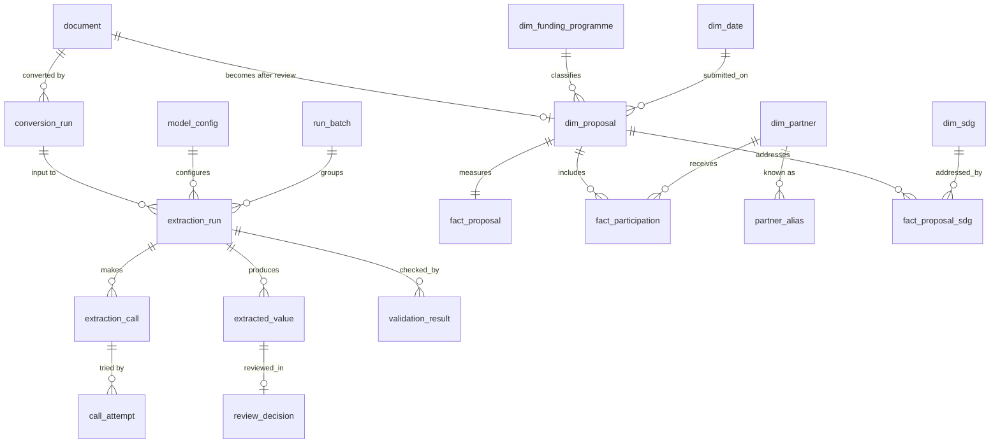

# Database conceptual model, pass 1

Two layers in one SQLite database. The **pipeline layer** records what happened to each document, so that every value can be traced and every model run compared. The **analytical layer** is a small star schema that serves the KPIs and can be queried by the custom application, by Power BI or by any other tool. Nothing enters the analytical layer before it has passed validation and human review.

## Layer 1: pipeline

1. **document.** One row per source file. Holds the file name, a content hash to prevent duplicates, the page count, the time it was received, its processing status and its storage path.
2. **conversion_run.** One row per conversion of a document to Markdown. Holds the method (native, OCR or mixed), the tool and its version, the number of pages sent to OCR, the path of the Markdown file and the duration. A document can be converted more than once, for example when the tool changes.
3. **model_config.** One row per extraction configuration under evaluation. Holds the configuration name, the model name, the provider, whether it runs locally, the prompt version (a SHA 256 digest of the prompts it uses), every parameter as JSON and the prices per million tokens in millionths of a US dollar, with their retrieval date. This entity is what makes Q2 answerable.
4. **extraction_run.** One row per run of one configuration over one document, within a run batch. Holds the input kind (Docling Markdown, through a conversion_run, or the PDF itself), the repetition, the attempt for that slot and whether it is the final one, the status and error, the start time, the durations (the configuration's own, from file to final JSON, and inside model calls), the number of calls, failed calls, HTTP attempts and retries, the context splits, the tokens consumed (input, output, reasoning, image, cached), the cost in millionths of a US dollar, whether the final record passed the schema, and the paths of the run files.
4a. **run_batch.** One row per batch of runs made together. Holds the code version (git commit and whether the working tree had uncommitted changes), the SHA 256 of every prompt and of the schema, the price file with its digest and retrieval dates, the path of the run manifest, and the start and end time.
4b. **extraction_call.** One row per model call of a run, failed calls included. Holds the purpose (extraction or page picking), the outcome and error, the model and provider, whether a response schema was enforced, the request size, the duration, the token counts and the provider's usage object unchanged, the cost, the finish reason, and the reply exactly as returned with any separate reasoning text. Every raw output is therefore kept beside its usage.
4c. **call_attempt.** One row per HTTP attempt of a call, the first try and every retry, with its status, error and duration.
5. **extracted_value.** One row per field value produced by a run. Holds the target entity, the field name, the value as text, the page reference and, for partner level fields, the index of the partner within the proposal.
6. **validation_result.** One row per rule checked for a run. Holds the rule code, whether it passed, the severity and a message.
7. **review_decision.** One row per value presented to a human. Holds the proposed value, the final value, the decision (accepted, corrected, added or rejected), the reviewer and the time. This is where value_source is determined.

**Why extracted_value stores fields as rows rather than columns.** Every configuration writes into the same table, so a new model or a new field needs no schema change, and scoring against the reference becomes one query. The typed, column based form appears only in the analytical layer, after review.

## Layer 2: analytical, star schema

**Dimensions**

1. **dim_proposal.** One row per proposal. Acronym, title, call identifier, funding programme, funding source, submission date, status, and the link back to its document.
2. **dim_partner.** One row per partner. Canonical name, category, derived status (Activated, Pending or Rejected) and the CLIC flag.
3. **partner_alias.** Name variants linked to a partner, used by the matching step.
4. **dim_funding_programme.** Programme name and its funding source, EU or National. This is the lookup table CLIC maintains.
5. **dim_sdg.** The 17 goals, with number and title.
6. **dim_date.** Calendar dimension for submission and decision dates. Useful for operational views even though the scorecard shows the whole portfolio.

**Facts**

1. **fact_proposal.** Grain: one row per proposal. Measures: requested_total, granted_total, trl_start, trl_target, mcrl_start, mcrl_target, builds_on_previous, demo_activity_count. Serves KPI 1, 2, 4, 7, 8, 9 and 10.
2. **fact_participation.** Grain: one row per partner per proposal. Measures: requested amount and granted amount. Serves KPI 3, 5 and 6.
3. **fact_proposal_sdg.** Grain: one row per proposal per SDG. No measure, a bridge table. Serves KPI 11.

Totals in fact_proposal are the sums of fact_participation, so they are populated by the load step rather than entered, and a load time check confirms they agree.

## Relationships

## KPI views

Each KPI becomes one view, so the application and any other tool read a single object per indicator and the business rules live in one place. Two rules are built into every view:

1. Proposals with status Pending are excluded.
2. CLIC is excluded from KPI 3, 5 and 6, and included in the totals for KPI 2 and 4.

Partner status is derived rather than stored by hand: Activated when the partner appears in at least one Approved proposal, Pending when not Activated but present in a Pending proposal, Rejected otherwise.

## SQLite conventions

1. **Amounts as whole cents, in integer columns.** Floating point rounding would distort the funding KPIs.
2. **Dates as ISO 8601 text,** which sorts correctly and converts easily in Python.
3. **Yes or No as integer 0 or 1.**
4. **Foreign keys enabled explicitly,** since SQLite does not enforce them by default.
5. **Every table with a surrogate integer primary key,** plus a unique constraint on the natural key, for example the content hash on document.
6. **Standard SQL only,** so the model can be moved to PostgreSQL later without rewriting.

## Open points before pass 2

1. Whether a proposal can be resubmitted in a later call, which would need a link between proposals.
2. Whether the scorecard must show the decision date, which is not currently collected.
3. Whether project level fields beyond the proposal, for example the project acronym after the grant agreement, are needed.
